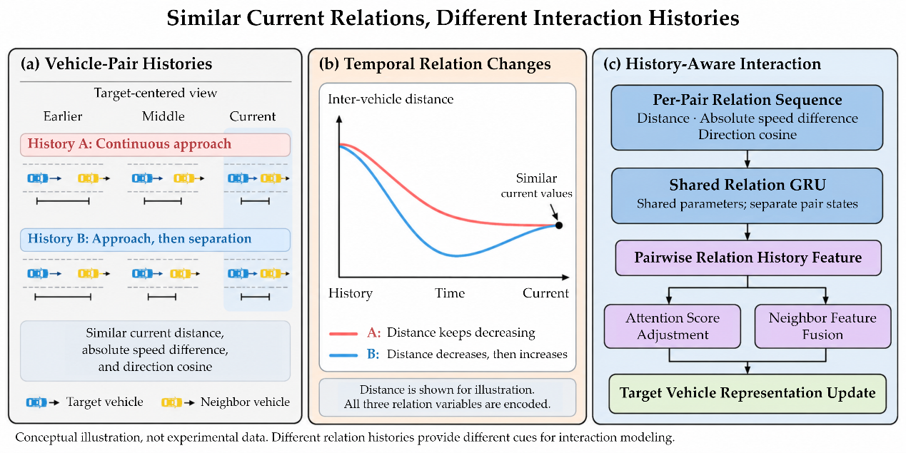
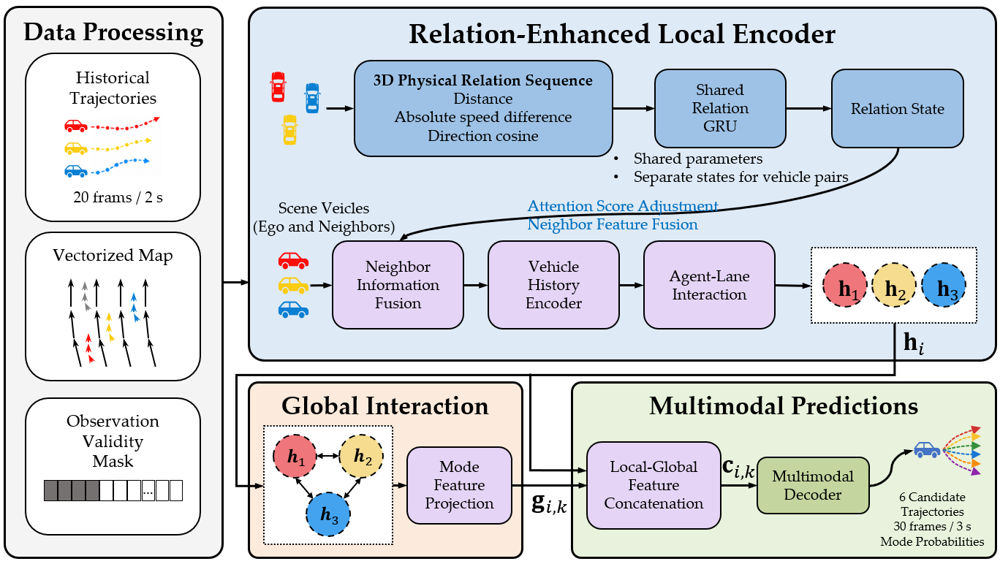
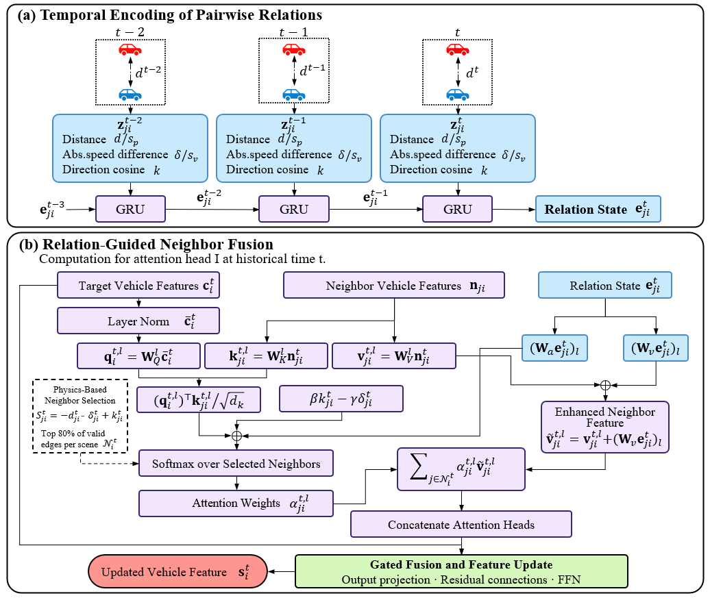
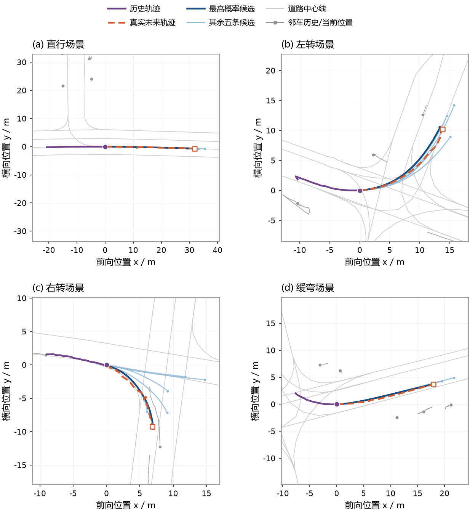

# Vehicle Trajectory Prediction via Temporal Encoding of Pairwise Relative Motion

A multimodal vehicle trajectory prediction method for autonomous driving. The
method preserves the history of each vehicle pair before aggregating neighbor
information, then uses that history to guide attention and feature fusion.

On the Argoverse 1 validation set, the full model achieves a minADE of 0.66 m,
a minFDE of 1.00 m, and a miss rate of 0.09 with approximately 652K parameters.
It uses 2 seconds of observations to predict six possible trajectories over
the next 3 seconds.

## Contents

- Overview and contributions
- Motivation
- Model framework
- Method details
- Dataset
- Training configuration
- Evaluation metrics
- Experimental results
- Qualitative results
- Limitations and future work
- Selected references

## Overview and Contributions

Vehicle trajectory prediction supports behavior decision-making and motion
planning in autonomous driving. A useful prediction must account for the
vehicle's own motion, surrounding traffic, and road geometry.

When neighbor features are aggregated independently at each observation time,
information from different neighbors is compressed into a vehicle-level
representation. This makes it difficult to retain and directly use the
interaction history of a particular vehicle pair.

The proposed method addresses this issue through three components:

1. Pairwise relation memory: A shared gated recurrent unit (GRU) encodes the
   history of inter-vehicle distance, absolute speed difference, and motion
   direction consistency. Each vehicle pair maintains its own hidden state.
2. Relation-guided interaction: The hidden relation state adjusts attention
   scores and augments the features transmitted by neighboring vehicles.
3. Integrated motion forecasting: Pairwise relation encoding is combined with
   vehicle history encoding, vehicle-lane interaction, global interaction,
   and multimodal trajectory decoding.

## Motivation

Two vehicle pairs can have similar distances, speed differences, and direction
consistency at the end of an observation window while having different
interaction histories. For example, one pair may approach continuously,
whereas another may first approach and then separate.

These histories can provide different forecasting cues even when the current
relation values are similar. The method therefore encodes each pair's relation
sequence before merging information from different neighbors.

Figure 1. Motivation for modeling pairwise relation histories. The illustration
contrasts different relative-motion histories with similar current relation
values and shows how relation history informs attention and neighbor fusion.
The scenes and curves are conceptual illustrations rather than measured data.

## Model Framework

The model receives historical vehicle positions, observation validity masks,
and a vectorized road map. Its processing stages are:

1. Validate observations and construct vehicle-centered coordinate systems.
2. Compute pairwise physical relation features over the observation window.
3. Encode relation sequences with a GRU and aggregate neighbor information.
4. Encode vehicle history with a temporal Transformer.
5. Fuse nearby lane geometry and semantic attributes.
6. Exchange information between vehicles through global attention.
7. Decode six future trajectories, distribution scales, and mode probabilities.

Figure 2. Overall prediction framework. Historical trajectories, validity masks,
and vectorized maps feed a relation-enhanced local encoder, a global interaction
module, and a multimodal decoder.

### Inputs and Outputs

| Item | Description |
| --- | --- |
| Vehicle history | Two-dimensional positions and validity masks |
| Map input | Lane segment endpoints and semantic attributes |
| Sampling frequency | 10 Hz |
| Observation window | 20 frames / 2 seconds |
| Prediction horizon | 30 frames / 3 seconds |
| Number of modes | 6 |
| Predicted positions | Six sequences of 30 two-dimensional positions |
| Distribution scales | Positive scales for both coordinates at each future step |
| Mode probabilities | Six normalized probabilities summing to one |

## Method Details

### 1. Preprocessing and Physical Relation Features

Velocity is estimated by backward differencing with a time interval of 0.1 s.
Both adjacent position observations must be valid for the velocity estimate to
be valid. Invalid position values are masked before differences are computed.

For each target vehicle, the local coordinate origin is its last valid
historical position. The reference direction is determined by its last valid
historical displacement. This reduces sensitivity to absolute scene position
and orientation.

For neighbor j and target i at time t, the relation variables are:

- Distance d: Euclidean distance between the two positions.
- Absolute speed difference delta: The absolute difference between the two
  velocity magnitudes, rather than the magnitude of the relative velocity.
- Direction consistency kappa: Cosine similarity between the two velocity
  vectors, clipped to the interval [-1, 1] with numerical stabilization.

The normalized relation vector is:

    z_ji(t) = [d_ji(t) / 50 m,
               delta_ji(t) / (10 m/s),
               kappa_ji(t)]

If either position is invalid, the pair does not participate in aggregation
at that time and its relation state is reset to zero. If both positions are
valid but the two velocities cannot both be estimated, distance is retained
while speed difference and direction consistency are set to zero.

### 2. Pairwise Temporal Relation Encoding

The three-dimensional relation vector is projected into a hidden feature space
and passed through a GRU:

    f_ji(t) = tanh(W_e z_ji(t) + b_e)
    e_ji(t) = GRU(f_ji(t), e_ji(t-1))

All vehicle pairs share the encoder parameters, but their hidden states are
stored separately using fixed pair indices. States are initialized to zero
at the start of each observation window. After an invalid observation resets
a pair's state, subsequent valid observations restart from zero.

Relation states continue to update for position-valid candidate pairs even
when their edges are temporarily excluded by neighbor selection. Aggregation
uses only the states associated with the selected neighbor edges.

### 3. Relation-Guided Neighbor Aggregation

The instantaneous physical score is:

    S_ji(t) = -d_ji(t) - delta_ji(t) + kappa_ji(t)

At each historical time, the model retains the highest-scoring 80% of valid
candidate edges within each scene. The retained edges define the neighbors
available to each target vehicle.

Target and neighbor motion features are transformed into the target vehicle's
local frame and embedded with multilayer perceptrons. A learnable beginning
token represents the start of a new valid observation segment.

For each attention head, the relation state contributes through two paths:

    attention_logit = query-key similarity / sqrt(head dimension)
                      + beta * kappa - gamma * delta
                      + projected relation-state bias

    enhanced_value = projected neighbor feature
                     + projected relation state

Beta and gamma are learnable parameters. Attention is normalized over the
selected neighbors, and the weighted messages are concatenated across heads.
Gated fusion, output projection, residual connections, layer normalization,
and a feed-forward network update the target representation. If no neighbors
are available, the neighbor context is set to zero.

Figure 3. Temporal relation encoding and relation-guided neighbor fusion.
Separate pair states preserve relation histories, which influence both
attention weights and the content of neighbor messages.

### 4. Vehicle History and Road Context

A temporal Transformer integrates the vehicle representations produced at
each historical time. The sequence includes learnable positional embeddings
and a final aggregation token. Invalid observations use a learnable padding
token, and a causal attention mask prevents access to later sequence positions.
The final aggregation token summarizes the historical sequence.

Pairwise temporal encoding operates before neighbor aggregation, while vehicle
history encoding operates after aggregation. These stages preserve relation
history and vehicle-level motion history at different levels.

Vehicle-lane attention then fuses lane segment direction, relative position,
and semantic attributes into the vehicle representation. Gated updates and
residual connections produce the local feature used by later modules.

### 5. Global Interaction and Multimodal Decoding

Global attention exchanges information among vehicles that are valid at the
end of the observation window. Relative position and the sine and cosine of
heading differences enter both attention keys and values.

The resulting representation is projected into six mode-specific global
features. Each is concatenated with the corresponding vehicle's local feature
and passed to regression and classification branches.

The decoder predicts position means, positive scale parameters, and mode
probabilities. Each mode uses independent Laplace distributions for the two
position coordinates. At inference, predicted position means are transformed
back into scene coordinates and returned with their mode probabilities.

### 6. Training Objective

The total loss combines regression and classification with equal weights:

    L_total = L_reg + L_cls

- Regression: Select the mode with the smallest accumulated Euclidean error
  over valid future timestamps. Apply Laplace negative log-likelihood to that
  mode and average over valid future positions and coordinate components.
- Classification: Convert the negative average displacement errors of all
  modes into soft target probabilities using softmax. Stop gradients through
  these targets and apply soft-label cross-entropy to vehicles with valid
  future annotations.

## Dataset

Experiments use the Argoverse 1 Motion Forecasting dataset, collected on real
roads in Miami and Pittsburgh. It provides trajectories and map information
including lane centerlines, connectivity, and turning attributes.

| Split | Number of scenes |
| --- | ---: |
| Training | 205,942 |
| Validation | 39,472 |
| Test | 78,143 |
| Total | 323,557 |

Training and validation scenes contain 5 seconds of observations at 10 Hz:
the first 20 frames are input and the remaining 30 frames are prediction
targets. Public test inputs contain historical observations without public
future ground truth. Standard evaluation targets the vehicle labeled AGENT
in each scene. The results below are validation-set results.

## Training Configuration

| Setting | Value |
| --- | --- |
| Operating system | Ubuntu 18.04 |
| Python | 3.8 |
| PyTorch | 1.8.1 |
| GPU | NVIDIA RTX 3090, 24 GB |
| Optimizer | AdamW |
| Initial learning rate | 5e-4 |
| Batch size | 32 |
| Training epochs | 64 |
| Weight decay | 1e-4 |
| Dropout | 0.1 |
| Learning rate schedule | Cosine annealing |
| Distance normalization scale | 50 m |
| Speed normalization scale | 10 m/s |
| Retained candidate edges | Top 80% per scene at each historical time |

All ablation variants use the same data splits, preprocessing, training
configuration, and evaluation procedure. Their vehicle history, lane
interaction, global interaction, and decoding components remain consistent.

## Evaluation Metrics

Each target vehicle receives six candidate trajectories. All three metrics
are lower-is-better.

- minADE: Following the Argoverse 1 evaluation protocol, first select the
  candidate with the smallest final displacement error, then calculate its
  mean Euclidean displacement error over the prediction horizon.
- minFDE: The smallest final-position Euclidean error among the six candidates.
- MR: The fraction of samples whose minFDE exceeds 2 m.

Displacement errors are measured in meters. MR is displayed as a fraction in
the following tables; 0.09 corresponds to 9%. The mode selection used for
regression training differs from the endpoint-based selection used to report
the evaluation metrics.

## Experimental Results

### Comparison on Argoverse 1 Validation

All methods use 2 seconds of history, predict 3 seconds into the future, and
output six candidate trajectories in the reported comparison.

| Model | minADE (m) | minFDE (m) | MR | Parameters |
| --- | ---: | ---: | ---: | ---: |
| Proposed method | 0.66 | 1.00 | 0.09 | 652K |
| HiVT | 0.69 | 1.04 | 0.10 | 662K |
| LaneGCN | 0.71 | 1.08 | 0.10 | 3,701K |
| DenseTNT | 0.75 | 1.05 | 0.10 | 1,103K |

Compared with HiVT, minADE decreases by 4.35% and minFDE by 3.85%, while the
parameter count decreases from 662K to 652K. The method also reports lower
displacement errors than LaneGCN and DenseTNT with a smaller parameter count.

### Ablation Study

The ablation distinguishes the effect of relation encoding from the effect
of carrying relation state across time:

- A: Baseline without the additional relation GRU branch.
- B: Per-frame relation encoding. The GRU starts from zero at every historical
  time, with no state carried over from the preceding time.
- C: Full temporal relation encoding with continuous state propagation.

Variants B and C use the same physical relation inputs and both fusion paths.
Each variant is trained independently.

| Variant | minADE (m) | minFDE (m) | MR |
| --- | ---: | ---: | ---: |
| A - Baseline | 0.69 | 1.04 | 0.10 |
| B - Per-frame relation encoding | 0.68 | 1.03 | 0.10 |
| C - Full temporal relation encoding | 0.66 | 1.00 | 0.09 |

Per-frame encoding improves the baseline slightly, and temporal state
propagation provides a further improvement. These results support the use
of relation history in addition to instantaneous relation features.

### Computational Cost

The baseline and full model are measured on the same NVIDIA GeForce RTX 3090
with batch size 1. The benchmark uses 1,000 validation scenes sampled with a
fixed random seed, 50 warm-up passes per model, and three independent runs.
It uses FP32, disables TF32, and synchronizes the GPU around forward passes.

Timing includes relation feature computation, state updates, neighbor
selection, local and global interaction, and decoding. It excludes disk I/O,
scene batching, and CPU-to-GPU transfer.

| Measurement | A - Baseline | C - Full model |
| --- | ---: | ---: |
| Run 1 mean latency (ms) | 58.62 | 82.90 |
| Run 2 mean latency (ms) | 59.02 | 82.89 |
| Run 3 mean latency (ms) | 58.64 | 80.84 |
| Overall mean latency (ms) | 58.76 | 82.21 |
| PyTorch peak allocated GPU memory (MB) | 69.58 | 69.84 |

The relation branch adds 2,848 parameters, approximately 0.44% of the baseline
parameter count. Its recurrent updates increase inference latency despite the
small parameter increase. These measurements do not establish end-to-end
real-time deployment performance.

## Qualitative Results

The selected validation examples cover straight driving, left turns, right
turns, and gentle curves. Each example shows one target vehicle's history,
ground-truth future, and six predicted trajectories. The candidate with the
highest predicted probability is highlighted.

Figure 4. Predictions for (a) straight driving, (b) a left turn, (c) a right
turn, and (d) a gentle curve. Dark blue denotes the highest-probability
candidate, light blue the other five candidates, orange dashed lines the
ground-truth future, and purple the observed history. Gray elements provide
lane and neighboring-vehicle context. Coordinates are in meters, centered on
the target vehicle and aligned with its current motion direction. Each panel
uses equal axis scaling and its own display range.

The highest-probability candidate has the following errors in these examples:

| Scenario | FDE (m) |
| --- | ---: |
| Straight driving | 0.130 |
| Left turn | 0.533 |
| Right turn | 0.271 |
| Gentle curve | 0.132 |

The straight-driving example also has an ADE of 0.071 m. These are individual
examples rather than aggregate validation metrics.
The plotted trajectories are actual inference outputs without smoothing,
offsets, or manual correction.

## Limitations and Future Work

- Computational cost: Pair states are updated before neighbor selection, so
  recurrent computation depends on observation length and the number of
  candidate vehicle pairs. Restricting candidate relations, updating states
  on demand, and reusing computation across overlapping windows may improve
  efficiency.
- Relation expressiveness: Distance, absolute speed difference, and direction
  consistency form a compact representation, but provide limited distinction
  between configurations such as longitudinal following and lateral travel.
  Relative bearing and distance change rate are possible extensions.
- Evaluation scope: Further evaluation across road environments, longer
  horizons, missing observations, and position perturbations would help
  characterize the method's applicability and robustness.

## Selected References

The method described here is based on the paper "Vehicle Trajectory Prediction
via Temporal Encoding of Pairwise Relative Motion."

- Chang et al. Argoverse: 3D Tracking and Forecasting with Rich Maps.
  CVPR, 2019.
- Zhou et al. HiVT: Hierarchical Vector Transformer for Multi-Agent Motion
  Prediction. CVPR, 2022.
- Liang et al. Learning Lane Graph Representations for Motion Forecasting.
  ECCV, 2020.
- Gu et al. DenseTNT: End-to-End Trajectory Prediction from Dense Goal Sets.
  ICCV, 2021.
- Yu et al. PLMT-Net: A Physics-Aware Lightweight Network for Multi-Agent
  Trajectory Prediction in Interactive Driving Scenarios. Drones, 2025.
